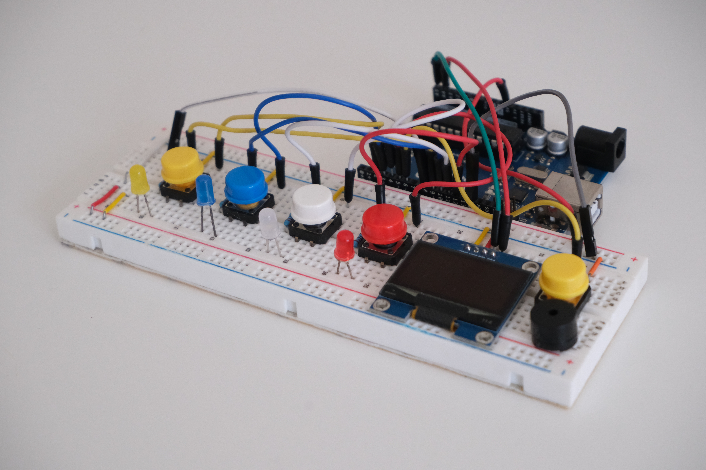
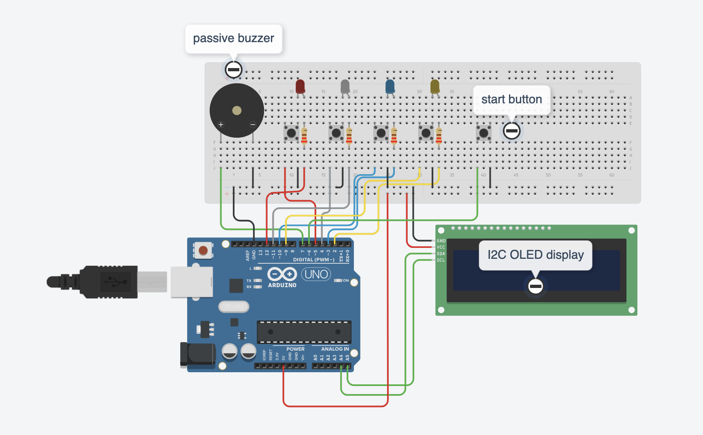

# Monkido

A Simon-style memory game for the ATmega328P (Arduino Uno), written in bare-metal C with no Arduino libraries. The board plays a growing sequence of LEDs and tones, and you repeat it on four buttons. Your score and an all-time high score show on a 128x64 I2C OLED; the high score is kept in EEPROM, so it survives power-off.

notes: monkido is a combination of monkey + do, a reference to monkey see, monkey do



## Features

- Four LEDs and four buttons matching colors with the LEDs, each paired with its own tone on a passive buzzer
- 128x64 OLED (I2C) showing START, the live score, GAME OVER, and the high score
- High score saved in EEPROM
- 3-second timeout per button press
- Debug log over UART at 9600 baud (8N1)
- Register-level drivers for GPIO, Timer1, TWI (I2C), ADC, USART and EEPROM, plus a hand-written 5x7 font and framebuffer for the display

## Hardware

# Hardware

| Part | Qty | Pin (Uno) | AVR pin |
|---|---|---|---|
| Arduino Uno (ATmega328P, 16 MHz) | 1 | – | – |
| LED: red, white, blue, yellow (LED0–LED3) | 4 | D9, D10, D11, D12 | PB1–PB4 |
| Resistor 220 Ω (one per LED) | 4 | in series with each LED | – |
| Push button, game (Button0–Button3), ideally with red, white, blue and yellow caps | 4 | D2, D3, D4, D5 | PD2–PD5 |
| Push button, start | 1 | D6 | PD6 |
| Passive buzzer | 1 | D8 | PB0 |
| SH1106 OLED, 1.3", 128x64, I2C, address 0x3C | 1 | A4 (SDA), A5 (SCL) | PC4, PC5 |
| Breadboard | 1 | – | – |
| Jumper wires | ~20 | – | – |
| Nothing connected (floating input, used as random seed) | – | A0 | ADC0 |

Wiring notes:

- Buttons connect between the pin and GND. The internal pull-ups are enabled, so a press reads LOW. No external resistors are needed.
- LEDs are active high: pin → resistor → LED anode, cathode → GND. LEDx lights for Buttonx.
- The buzzer must be **passive**. The firmware generates the square wave itself, so an active buzzer will not play the right tones.
- Leave A0 unconnected. The firmware reads its floating voltage once to seed the random generator.



! [Schematic](docs/hardware/schematic.pdf)

## How to play

1. Power on. The OLED shows **HI** (High Score) and the stored high score.
2. Press the start button. The screen shows `START`, then `SC 0` (Score 0).
3. The board plays the sequence: each step lights one LED and plays its tone.
4. Repeat the sequence on the buttons. Each press lights its LED and plays its tone.
5. Get it right and the score goes up by one and the sequence grows by one step.
6. A wrong button, or no press within 3 seconds, ends the game. The OLED shows `GAME OVER!!`, then your score and the high score, then the high score alone. Press START to play again.

Your score is the number of rounds you completed. A new record is written to EEPROM immediately.

## Build and flash

Requirements: Atmel Studio 7 or Microchip Studio (Windows), and the Uno's USB bootloader with `avrdude`.

1. Open `monkido.atsln` in Atmel Studio.
2. Pick the `Debug` (`-Og`) or `Release` (`-Os`) configuration and build (F7). The output is `monkido/<Configuration>/monkido.hex`.
3. Flash it.
   - Over USB with the Uno bootloader:
     ```
     avrdude -c arduino -p m328p -P <COM_PORT> -b 115200 -U flash:w:monkido/Debug/monkido.hex:i
     ```
4. Optional: open a serial monitor at 9600 baud to see `READY`, `START`, `LEVEL n` and the game-over summary.

`F_CPU` is defined as 16 MHz in `main.c`. Change it if your board runs at a different clock.

Footprint (Debug build): about 4.0 KB of 32 KB flash, and 1340 of 2048 bytes of static RAM, most of it the 1 KB OLED framebuffer.

## Project structure

```
.
├── README.md
├── LICENSE
├── .gitignore
├── monkido.atsln          Atmel Studio solution
├── monkido/
│   ├── main.c             all firmware: drivers, display, game logic
│   ├── pitches.h          note name → frequency (Hz) table
│   └── monkido.cproj      Atmel Studio project
└── docs/images/           photos and schematic
```

## How it works

- **Timing.** Timer1 runs in CTC mode with prescaler 64 and `OCR1A = 249`, giving a 1 ms interrupt that drives `millis()`. This is used for the button timeout.
- **Sound.** `playTone()` bit-bangs PB0 high and low with a busy-wait loop. Tones are B6 (1976 Hz), C4 (262 Hz), D8 (4699 Hz) and G5 (784 Hz).
- **Display.** A 1 KB framebuffer in RAM is drawn into with a 5x7 font and then pushed to the OLED page by page over TWI at 400 kHz.
- **Randomness.** One ADC reading of the floating A0 pin seeds `rand()`.
- **Persistence.** The high score is one byte in EEPROM. `0xFF` (erased) is treated as 0, and writes use `eeprom_update_byte()` to avoid needless wear.
- **Control flow.** Everything runs in a single loop in `main()`: wait for START, extend the sequence, play it, read the input, then update the score or end the game.

## Known limitations

- **Tones are wrong by about 11x.** `playTone()` counts loop iterations as if each took one CPU cycle, but each iteration takes about 11 cycles (checked in the Debug `.lss`). Tones play roughly 11x lower in pitch and 11x longer than the code intends. well.. I need to fix that some day - for now.. it works :)).
- **Blocking design.** Tones, delays and display updates all busy-wait, so nothing else can happen while they run, and buttons are read only while the game waits for input. (Let me see how many people get annoyed, then I will fix it.)
- **No I2C error handling.** The TWI driver never checks ACK/status codes. A missing or miswired OLED is not detected.
- **Display controller.** The code is named for the SSD1306, but it writes with a column offset of 2, which matches the SH1106 used on 1.3" modules. (it is an SH1106, the code functions and it is just a naming confusion)
- **Weak random seed.** A single reading of a floating pin can repeat between power-ups.
- **Length cap.** The sequence stops growing at 49 steps; after that the last step is replaced each round. Scores display up to 99. (I will fix it later, nobody has reached a score of 20 yet, so let me not worry about this.)

## License

This project is licensed under the MIT License. See [LICENSE](LICENSE) for details.

## Notes
A version 2 of this will come. It will resolve all the limitations mentioned above, as well as some new features. The game will be moved from a breadboard to a PCD board. 

This is a link to a video of someone playing
[Watch the demo video](https://drive.google.com/file/d/1nadUwm8wU0s0cfuSINVw-0tVQTaJuW5n/view?usp=sharing).